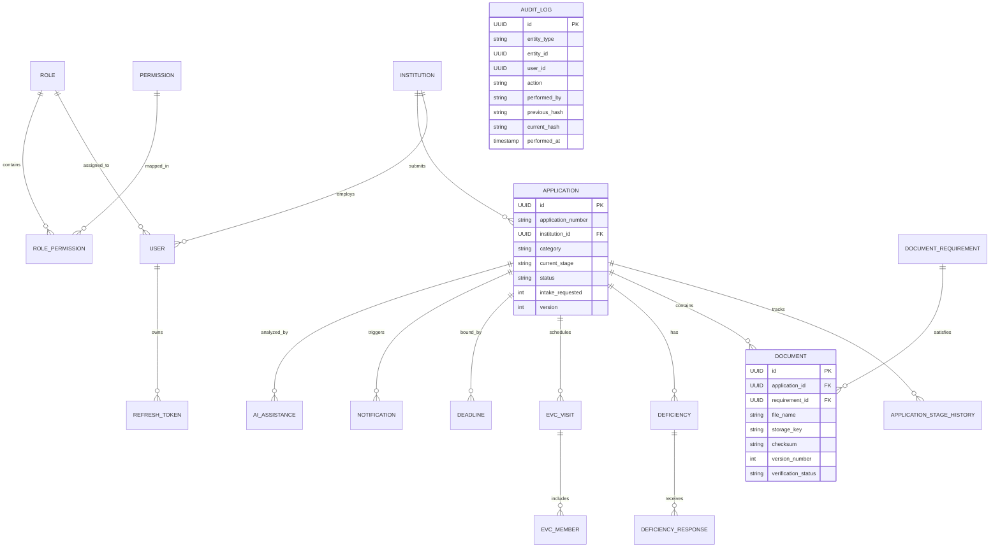

# Entity-Relationship (ER) Diagram

> **Important Notice:** This is a prototype workflow-management system for academic demonstration. It supports human-supervised administrative processing and does not replace official AICTE systems, statutory scrutiny, inspection, committee review, or competent-authority decisions.

